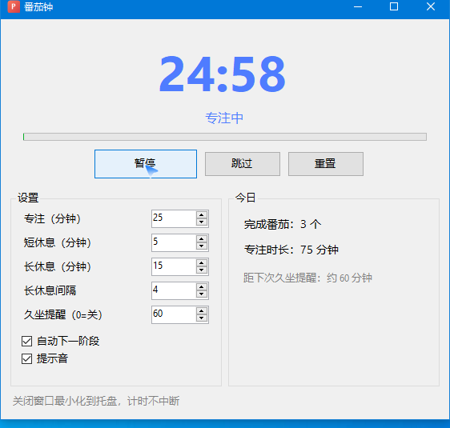

# PomodoroTimer

一个 42 KB 的 Windows 番茄钟：专注 / 休息自动循环，今日进度一眼看到。
原生 WinForm（.NET Framework 4.8），双击 exe 即用，无第三方依赖、不写注册表。



## 功能

- 大字号倒计时 + 进度条，开始 / 暂停 / 继续 / 跳过 / 重置
- 专注 → 短休息 → 专注 …… 循环，每完成设定数量的番茄进入一次长休息（默认 4 个）
- 「自动下一阶段」开启时自动开始下一段，关闭则停下来等你点开始
- 提示音 + 托盘气泡提醒：番茄完成、休息结束
- **今日统计**：完成番茄数、专注分钟数，跨天自动清零
- **久坐提醒**：连续专注达到设定分钟数（默认 60，填 0 关闭）时提醒起来活动，右下角实时显示距下次提醒还有多久
- 专注 / 短休息 / 长休息时长、长休息间隔都可调，改完立刻保存，下次启动沿用
- 关闭窗口收进托盘，计时不中断；双击托盘图标恢复窗口；托盘右键可退出

## 数据位置

```
%AppData%\PomodoroTimer\
  settings.ini   时长设置与今日统计
```

主要设置项：`pomo.focus`（专注分钟，默认 25）、`pomo.short`（短休息，5）、`pomo.long`（长休息，15）、`pomo.interval`（长休息间隔，4）、`pomo.sedentary`（久坐提醒分钟，60，0 = 关闭）、`pomo.autoNext`、`pomo.sound`。

## 运行

从 [Releases](../../releases) 下载 exe，双击即可。
首次运行 Windows SmartScreen 可能提示「未知发布者」，点「更多信息 → 仍要运行」。

## 自行编译

需要 .NET Framework 4.8 引用程序集（安装 Visual Studio 2022 即自带）。

```bash
git clone https://github.com/MYY114/PomodoroTimer.git
cd PomodoroTimer
dotnet build -c Release
```

产物在 `bin\Release\net48\PomodoroTimer.exe`。
`MainForm.Designer.cs` 是标准设计器代码，可直接用 Visual Studio 窗体设计器修改界面。

## 已知限制

- 计时状态不跨进程保存：关掉程序（右键托盘退出）后，当天统计会保留，但未完成的这轮计时不会续上
- 仅支持 Windows

## License

[MIT](LICENSE)
